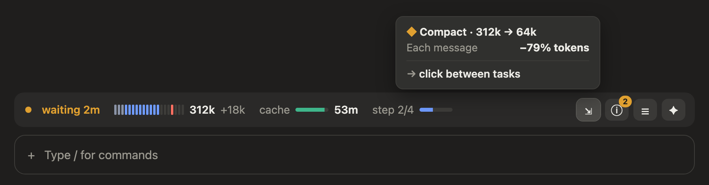
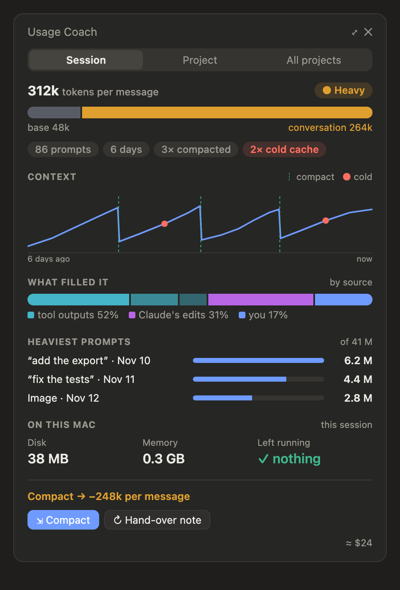
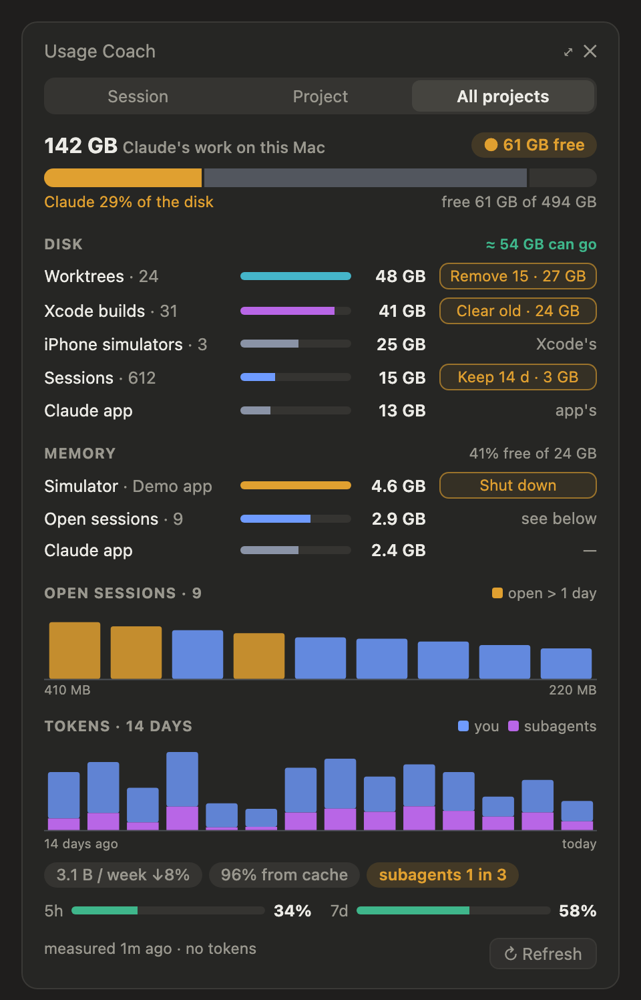

# Usage Coach

**See where your Claude Code tokens go, and the one change that saves the most right now.**

Usage Coach is a Claude Code mod: a strip above the prompt and a side pane. It uses only figures Claude Code already reports, never calls the model on its own and sends nothing anywhere. Watching it costs **zero tokens**.



<p>
  
  
</p>

The images use demo data.

## Install

In Claude Code:

```
/plugin marketplace add gabrieloy-star/claude-usage-coach
/plugin install usage-coach@gabriel-mods
```

Then start a new session. To update: `/plugin marketplace update gabriel-mods`, then `/reload-plugins`. To remove: `/plugin uninstall usage-coach@gabriel-mods`.

Needs Claude Code with mods (terminal, desktop app or VS Code; hover cards show on the desktop app) and Node.js for the pane's readings. Without Node.js, the strip and compacting still work.

## Why

Every message re-sends the whole conversation, so a 400k conversation costs more per message than a 40k one. The prompt cache keeps that cheap, but it expires after an hour, and the next message pays full price again. Usage Coach shows each of these and says what to do: a fact with a number, then one step.

## The strip

One line above the prompt. When space runs short, the least useful parts drop out first. Hover a part for a short card that ends with what to do.

| Part | What it shows |
| --- | --- |
| **Waiting** | How long Claude has waited for your answer to its question. |
| **Context** | Tokens in context, with a red line at the context ceiling, and what the last message added. |
| **Prompt cache** | Time left before the cache expires. Turns amber, then red. |
| **Steps** | Claude's step list, as "step 2 of 3" with a bar. |
| **⇲** | Compacts the conversation. Its card says how much smaller each message gets. |
| **ⓘ** | Insights, with their count. Shows only when there are some. |
| **☰** | Opens the side pane. Its card shows the model and both usage limits. |
| **✦** | Asks Claude where the project stands. It sends one message, like typing it yourself. |

## The side pane

Open it with `/usage-coach` or **☰**. Three views:

- **Session:** how the context grew request by request, what filled it, your heaviest prompts, and what this session uses on your Mac.
- **Project:** this project's sessions, worktrees and Xcode builds on disk, with buttons to clear old ones.
- **All projects:** disk and memory used by Claude's sessions, worktrees, Xcode builds and simulators, the sessions open now, and tokens per day over 14 days.

Every button that removes or stops something asks first and checks again before it acts. Files go to the Trash, never deleted for good. Worktrees are removed only when merged and clean, never with `--force`.

## Idle compact

If you leave a large session idle, Usage Coach compacts it 5 minutes before the 1-hour cache expires. Coming back then costs a short summary instead of the whole conversation. What each compaction saved is counted once it pays off, and kept for 7 days on your machine.

## Settings

Change them with `/plugin configure usage-coach@gabriel-mods`.

| Setting | Default | What it does |
| --- | --- | --- |
| Session budget | $100 | One notice when a session passes it. 0 turns it off. |
| Smallest saving worth suggesting | $1 | Smaller savings over an hour are not shown. |
| Context ceiling | 500k | Past it, compacting is suggested and the red line sits there. 0 puts the line at 85% of the window. |
| Idle compact: minutes before the cache expires | 5 | 0 turns idle compact off. |
| Smallest conversation worth compacting | 40,000 tokens | Below it, idle compact does nothing. |
| Cost line after each answer | off | A dim line with each answer's figures. |

## What it reads, runs and sends

Nothing leaves your machine. Usage Coach makes no network requests.

- **Reads:** the figures Claude Code reports (context, cost at list prices, usage limits, cache), token counts per request, tool names and output sizes, Claude's step titles and question headers, and the first 60 characters of each request (kept in memory to label costs). For the pane it reads your transcripts in `~/.claude/projects` and the desktop app's session list.
- **Runs:** Node.js scripts in `scripts/` (`week.mjs`, `session.mjs`, `disk.mjs`, `mac.mjs`) that measure files and processes, using `ps`, `lsof`, `du`, `df`, `sysctl`, `memory_pressure`, `plutil`, `xcrun simctl list` and read-only `git` commands. Only after you press a button and confirm: move files to the Trash, `git worktree remove`, `xcrun simctl shutdown`, or `open -R` to show a file in Finder.
- **Sends Claude, as your own message, only when you press the button:** the status question (✦), a hand-over note request, or a request to set `cleanupPeriodDays` in `~/.claude/settings.json`.
- **Slash commands:** `/compact`, when you press **⇲** or **Compact**, and for idle compact.
- **Adds:** the `/usage-coach` command, answered locally at no token cost.

## Troubleshooting

- **The strip does not show.** Start a new session, or run `/reload-plugins` after an update.
- **The pane shows no readings.** Check that `node --version` works in a terminal, then press **↻ Refresh**.
- **The cost differs from my bill.** Costs are at API list prices. On a Pro or Max plan you pay the plan; the figures show where the usage goes.
- **Something else.** Open an [issue](https://github.com/gabrieloy-star/claude-usage-coach/issues) with your `claude --version`.

## Credits

Thanks to the people whose mods shaped the ideas here:
Chris Han ([context-window](https://github.com/chrishan17/claude-mod-context-window)),
David Roberts ([claude-idle-compact](https://github.com/davidar/claude-idle-compact)),
Eric Cologni ([token-weather-usage](https://github.com/augiefra/claude-mods))
and Anthropic (session-report).
